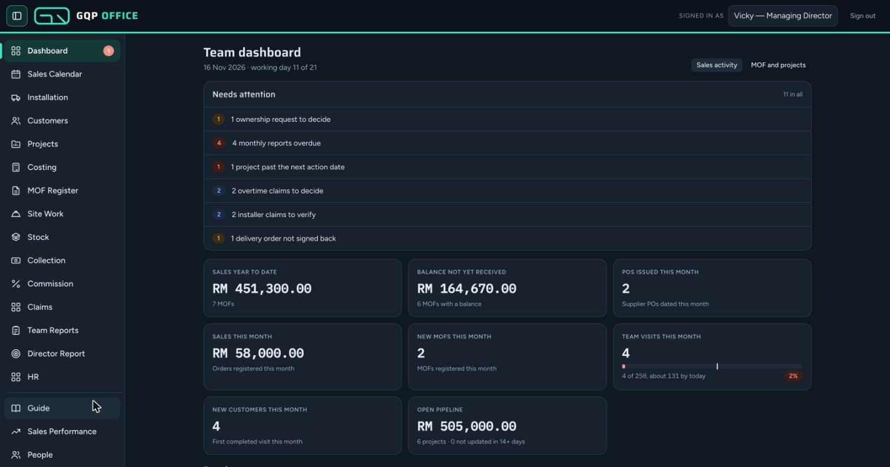
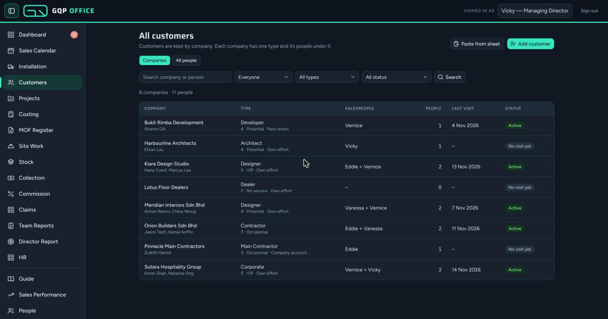
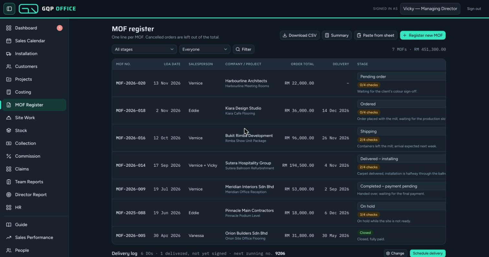

# GQP Office

Invite-only internal app for GQ Projects, a 17-person carpet sales and installation company. People sign in with
Google; admins add them, and there is no public sign-up. The code is also built to be extended by non-developers
working with a coding agent, so the repo carries its own rules and docs.

## What it does

One sidebar lists the pages each person's job role may open. The Managing Director sets who sees what in People.

| Area | Pages |
|---|---|
| Sales | Dashboard, Sales Calendar, Customers, Projects, Costing |
| Orders and delivery | MOF Register, Installation, Site Work, Stock, Collection |
| Money | Commission, Claims (commission, travel, overtime) |
| Reporting | Team Reports, Director Report |
| People | HR, Tasks, Leave, Tools & Forms, People |

Every screen is described in [docs/features.md](docs/features.md), with pictures for most.

## Stack

- Next.js 16 (App Router), React 19, TypeScript (strict)
- Supabase (Postgres, Auth, row-level security)
- shadcn/ui, Radix, Tailwind 4
- Zod for validation, Vitest for tests, Biome for lint and format
- Vercel for hosting; pnpm as package manager

## Run locally

1. Install dependencies: `pnpm install`.
2. `.env.development` is committed and holds the public Supabase values for the dev project (`gq-crm-dev`):
   `NEXT_PUBLIC_SUPABASE_URL` and `NEXT_PUBLIC_SUPABASE_PUBLISHABLE_KEY`.
3. Server-only features need `SUPABASE_SERVICE_ROLE_KEY`. It is not committed and not set locally, so admin-only
   server features show a "can't be tried on your laptop" message by design.
4. `pnpm dev`, then open `http://localhost:3000`. Google sign-in is off there; use the "Sign in as" panel at the bottom of the page.

Seeding admins and example data: see [docs/environments.md](docs/environments.md).

## Scripts

| Script | What it does |
|---|---|
| `pnpm dev` | Start the dev server |
| `pnpm build` | Production build |
| `pnpm start` | Serve the production build |
| `pnpm check` | Biome lint and format check |
| `pnpm format` | Biome format, write changes |
| `pnpm typecheck` | `next typegen` then `tsc --noEmit` |
| `pnpm test` | Vitest, single run |
| `pnpm guard:migrations` | Block migrations that drop, rename, retype or delete stored data |
| `pnpm seed:example` | Load example data into the dev database |

## Folder map

| Path | Contents |
|---|---|
| `src/app/` | Routes: `(app)` signed-in pages, `(auth)` sign-in, `dev` component showcase |
| `src/components/` | `app` (CRM components) and `ui` (shadcn primitives) |
| `src/hooks/` | Shared React hooks |
| `src/lib/` | `auth`, `domain`, `form`, `format`, `import`, `supabase` helpers |
| `supabase/` | `config.toml` and `migrations/` (every database change is a new file) |
| `scripts/` | Migration guard, admin seeding, example data seeding |
| `docs/` | Decisions, environments, design system, glossary, onboarding, debt, loop history |

## Roles

Two access roles: `admin` (manages people and settings) and `staff` (day-to-day use). On top of that each person has
a job role (MD, directors, salesperson, site supervisor and others) that decides which pages they see.

## Working on a change

Read [CLAUDE.md](CLAUDE.md). In short: work on a branch or worktree, keep the change small, run `pnpm check`,
`pnpm typecheck` and `pnpm test`, preview it, then put it live. Database changes go through
`supabase/migrations`, checked by the migration guard in CI.

## Docs

- [docs/features.md](docs/features.md): what the app does today
- [docs/decisions.md](docs/decisions.md): why things are the way they are
- [docs/environments.md](docs/environments.md): Supabase projects, Vercel, keys, seeding
- [docs/design-system.md](docs/design-system.md): UI rules and tokens
- [docs/glossary.md](docs/glossary.md): the business words used in the app and in chat
- [docs/onboarding.md](docs/onboarding.md): adding an editor to the repo
- [docs/debt.md](docs/debt.md): known shortcuts
- [docs/desktop-findings.md](docs/desktop-findings.md): Claude Desktop (Code mode) test results
- `docs/loops/`: build plan history
