# Features

One section per screen, in sidebar order. Screenshots are the Managing Director's view of the development database
with its example records (fake names and numbers), so a colleague with another job role sees fewer or different screens
and records. The in-app **Guide** lists what each role can open. Not every screen has a picture.

Job roles: MD, Sales Director, Marketing Director, Salesperson, HR & Accounts, Site Supervisor, Purchasing, Sales support, Designer, Marketing Executive. The MD sets which pages each role sees in People ("What each role can see") and can open the app as anyone with **View as** (read only).

## Contents
- [Header and sidebar](#header-and-sidebar)
- [Sign in](#sign-in)
- [Dashboard](#dashboard)
- [Sales Calendar](#sales-calendar)
- [Log work](#log-work)
- [Installation](#installation)
- [Costing](#costing)
- [Customers](#customers)
- [Customer detail](#customer-detail)
- [Ownership requests](#ownership-requests)
- [Projects](#projects)
- [MOF Register](#mof-register)
- [MOF detail](#mof-detail)
- [Site Work](#site-work)
- [Site Work detail](#site-work-detail)
- [Claims](#claims)
- [Overtime](#overtime)
- [Stock](#stock)
- [Samples](#samples)
- [Leftover stock](#leftover-stock)
- [Collection](#collection)
- [Commission](#commission)
- [Commission settings](#commission-settings)
- [Team Reports](#team-reports)
- [Director Report](#director-report)
- [Tasks](#tasks)
- [HR](#hr)
- [Tools & Forms](#tools--forms)
- [Leave](#leave)
- [Guide](#guide)
- [Sales Performance](#sales-performance)
- [People](#people)

## Header and sidebar
The header shows the logo, the app name, who is signed in (name and job title) and **Sign out**. The sidebar lists the
pages the person's role may open, then a divider, the **Guide**, and the pages that sit below it (Sales Performance and
People for admins). A badge on a link shows a count, e.g. open ownership requests on the **Dashboard**. The menu button
at the top left collapses the sidebar to icons on a laptop and opens it as a drawer on a phone; the laptop choice is
remembered in the browser.

Used by: everyone.

## Sign in
Invite-only sign-in with Google, using the account an admin added in People. There is no public sign-up and no
password in the app. On a laptop (development) Google sign-in is off; a "Sign in as" panel lists the test people
instead.

Used by: everyone.

## Dashboard
Headline numbers for the month: what needs attention, visits against target, new customers, open pipeline,
awarded and yearly sales, and money still outstanding, with a row per salesperson. Salespeople and site
supervisors get a personal version.

Used by: MD, Sales Director, BD Director, Sales, HR & Accounts, Purchasing.

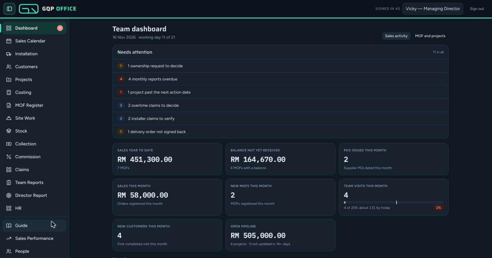

## Sales Calendar
Three tabs: Week, Monthly list and Weekly outcomes. Add a visit or follow-up from any day, or **Plan a call**.
Managers get a **Who** filter ("My team" or one person).

Each visit ends with **Log outcome**: the result, what was learned (15 characters or more), an optional project lead
and a next step with a follow-up date. Logging after the visit is recorded as late. A visit still planned after its
start time shows as needing an outcome.

A visit can invite colleagues. They get a pending invitation and answer Accept or Decline; the creator sees the answers.

Weekly outcomes shows one week per salesperson: visits done, logged, not logged and late, results, new leads and the
weekly report status. Salespeople submit their weekly report there (due Friday 18:00, blocked while outcomes are
unlogged); the MD, Sales Director or team lead marks it reviewed.

Used by: MD, Sales Director, BD Director, Sales, HR & Accounts.

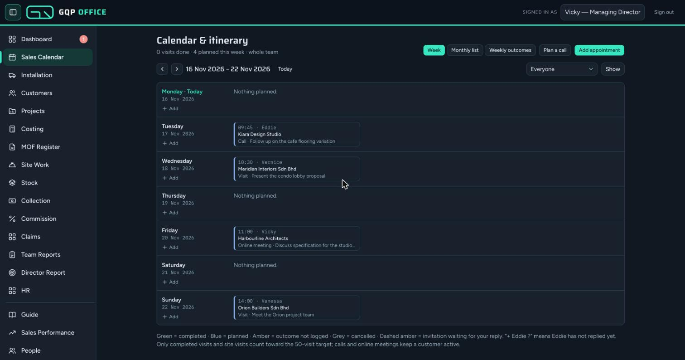

## Log work
The first page a Site Supervisor sees. Built for a phone, with a bar at the bottom that stays in view.
- **Home**: visits this month against the target, **Jobs planned for you** (installs and bookings), **Already recorded**
  for the day, and a **Leave / MC / office** button. Banners show open follow-ups, past days with nothing logged ("missed
  days") and work that was planned but not recorded. They are worked out when the page opens; nothing is sent.
- **Away days**: Leave and MC open the apply-leave sheet in Leave, so there is one balance in one place. Office and
  other days are kept on this page. Public holidays are not asked for.
- **Log a visit, four steps**: 1 Site (pick a MOF, or "new site, no MOF yet" with the salesperson, site name and an
  optional project); 2 Activities (tick any of Inspection, Measurement, Delivery, Installation, Shooting, Handover,
  Touch Up, Stock return); 3 Details for each activity (installation % done, with a warning if it is lower than last
  time; measurement sent to the salesperson; shooting posted; delivery all OK or a problem; handover form signed and
  four or more completed photos posted; balance stock to send back; a problem, with who owns the follow-up, a due
  date and a note); 4 Saved, with a WhatsApp link to the office for the stock-return text.
- Each activity is its own line in the site log. Photos and videos are not uploaded: they go to the WhatsApp group.
- **Not built yet**: a "Didn't go" choice, and a saved office WhatsApp number (the link opens WhatsApp and you pick the
  chat). Balance stock is kept as the typed answer only until the Stock loop.

BM labels cover the page, the wizard and Site Work. Messages shown after saving and the WhatsApp texts stay in English.

Used by: Site Supervisor (lands here), and any role the MD gives the page to.

## Installation
Delivery, site measurement, handover and installation jobs, in three views: **Installers** (the calendar),
**Site supervisors** and **Installer contacts**. Site supervisors see it as the Installation Calendar, Purchasing as
Delivery & Installation.
- **Installers**: the month calendar. Filter by installer and by site supervisor. A panel lists **DOs not yet signed &
  returned**. Schedule a job, or book a site supervisor when one is free.
- **Installer contacts**: the directory of installers: name, company, two phones (each with a WhatsApp link), what they
  can do, area, notes, how many jobs and the last job. Search by name, phone, skill or area; inactive installers are
  hidden until you tick **Show inactive**. MD, Sales Director, Site Supervisor, Purchasing and stock arrangers can add
  and edit.
- **Who sees which jobs**: the Sales Director and the Marketing Director see only jobs whose MOF they can read, in the
  calendar and in **DOs not yet signed & returned**. Jobs of other people's MOFs are left out.
- **Site supervisors**: a week list of each supervisor's jobs and bookings, and the bookings coming up. A booking is
  Requested, Confirmed or Declined. Sales, BD, MD and the Director book; only the supervisor answers their own, and a
  reason is saved when they decline.
- **Job form**: pick the installer from the directory, choose the team (a Site Supervisor, or **Supervisor only**),
  the salesperson in charge and remarks. Old jobs keep the installer name they were saved with.
- **DO numbers**: the app issues them. Tick **Issue DO no. now** on a delivery job and it gets the next number, shown as
  the MOF no plus four digits (for example P15915547). A job cannot be marked Done until it has a DO number. A cancelled
  or deleted DO number goes on a void list and is never used again. MD, Purchasing and HR & Accounts set the next
  number once, in **Next DO running number**, and it must be higher than the last one used or cancelled. Only the MD
  can correct a number after it is issued.
- **DO items**: product, item code, description, batch, unit, quantity and what it covers, with what was already
  delivered on earlier DOs shown beside each product. **Copy products from the MOF** fills the list.
- **Print DO**: an A4 Delivery Order with bill-to, deliver-to, client PO, salesperson, site contact, office contact,
  the items, Partial or Final, and the signature block. It warns, but does not stop you, when the MOF payment check or
  the DO pre-approval box is not ticked.
- **Delivery log**: on the MOF Register, one row per DO with the DO no, MOF, company, project, date, transporter, job
  scope, partial or full, passed to supplier, signed and returned, items, remarks and project delivered. It also lists
  the cancelled DO numbers. Delivery orders of a MOF the person cannot read are left out (the Marketing Director).
- **Not built**: the Coming up table and a Team size on the calendar.

Used by: MD, Sales Director, BD Director, Sales, HR & Accounts, Site Supervisor, Purchasing.

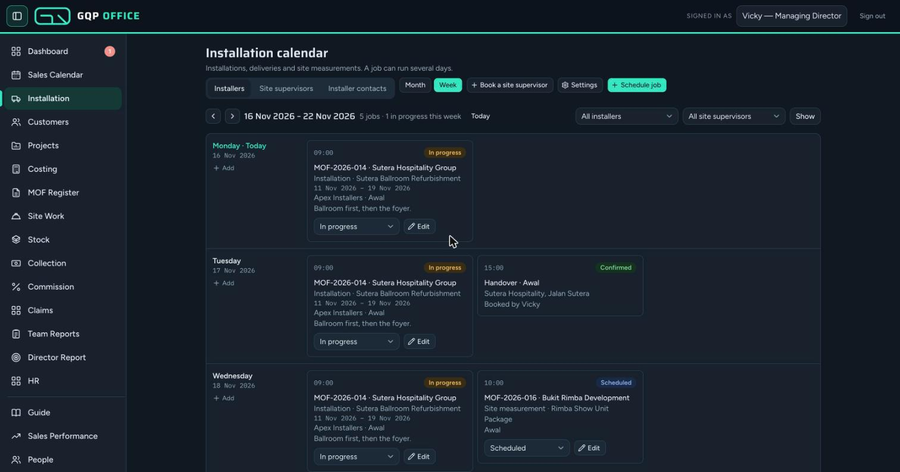

## Costing
Quotes with revisions (Original, R1, R2) and options (A, B, C) built from line items; sell, cost and margin per option.
Screens: **Register** (`/costing`: search, status filter, sort), **New quote**, **Quote record** (`/costing/[id]`:
editor, history, client quote button), **Approvals** (below-minimum-margin quotes: approve or return with a note),
**FOB Enquiry** (`/costing/enquiries`: ask for a supplier price, purchasing and support reply), **Client quote**
(`/costing/[id]/preview`: one option or a comparison, print, copy as TSV). Projects show their costing lines on the
card. A quote at or above the minimum margin (30%) is confirmed by its owner; below it needs a reason and the MD or a
Director approves. People without the "See margin % and cost" access see "Low / High margin" and no costs. English
with a 中文 toggle. Sales Directors, the MD, Sales support and HR & Accounts see every quote; salespeople see their own.

Used by: MD, Directors, Salespeople, Sales support, HR & Accounts, Purchasing (FOB Enquiry).

## Customers
Two views. **Companies** (the default) lists each company with type, salespeople, people, last visit and status
(Active, Quiet, or No visit yet). Filter by search, salesperson, type and status. **All people** is every customer with
company, mobile, owner, rating, account type and activity. Search and filter, add a customer, paste rows from a sheet or
download a CSV. The mobile number decides who owns a customer.

Click a company to open its sheet: its people, visits, **Edit company**, **Add person** and **Log visit**. A company's
salespeople are the owners of its people; only they (or the MD or Sales Director) add people to it.

Used by: MD, Sales Director, BD Director, Sales, HR & Accounts.

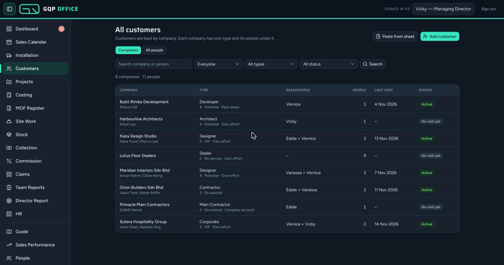

## Customer detail
One customer's contact details, owners, rating and health, colleagues at the same company, and the activity
history with the option to log a new one. The owner or a manager edits it; anyone else can ask for ownership.

Used by: MD, Sales Director, BD Director, Sales, HR & Accounts.

## Ownership requests
Requests from a salesperson to take over a customer, with the reason, who owns it now and the outcome.
Managers approve or reject; approving makes the requester the owner.

Used by: MD, Sales Director, BD Director, Sales, HR & Accounts.

## Projects
Every deal by stage from lead to job, as a board or a list, with value, area, estimated commission and the
next action date. Overdue next actions are flagged and a project's stage changes from its card. A Site
Supervisor sees only the projects they are on, with a Person filter over the people on those projects.

Used by: MD, Sales Director, BD Director, Sales, HR & Accounts.

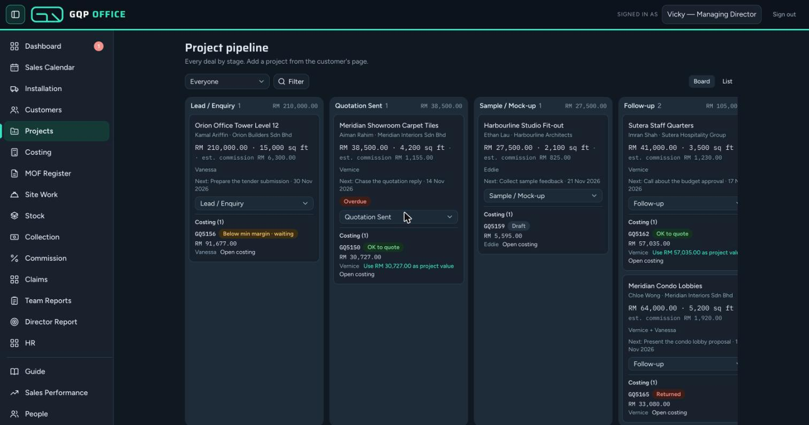

## MOF Register
The register of client purchase orders (MOFs): the order as it comes in, then supplier orders and deliveries.
Salespeople see their own as My Sales. Paste from a sheet or export to CSV. HR & Accounts can read it but not
change it.

Used by: MD, BD Director, Sales, HR & Accounts, Purchasing.

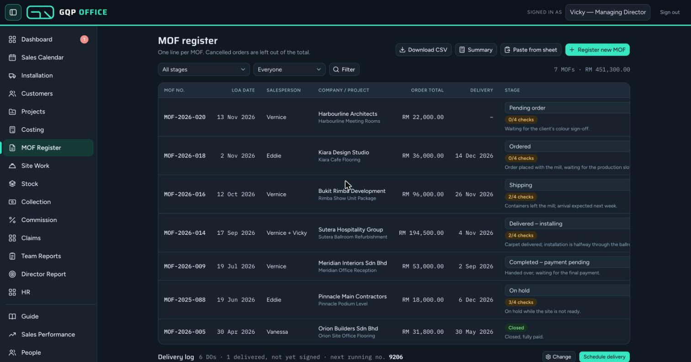

## MOF detail
One MOF with its products, contract sum and variation orders, supplier purchase orders, delivery jobs and
installer claims. A new MOF is registered here once the PO or LOA is received.

Variation orders (extra work signed after the order) are added on the MOF with their own number, date, amount and
description. The contract sum is the order plus its variation orders, and a variation order counts as sales in the
month it is confirmed. If a variation order needs more site work on a job that was finished, the job goes back to
installation and the Site Supervisor's dashboard shows an "additional work" alert until they tick **OK, noted**.
Salespeople do not see variation order costs.

Every change to a MOF is kept in its history, field by field: contract sum, cost, installer, scope, who is in
charge, support, account type, LOA date and items, with the old and new value, who changed it and why. A reason is
required when the job is complete or the order total changes. Cost rows are hidden from people who cannot see cost.

Used by: MD, BD Director, Sales, HR & Accounts, Purchasing.

## Site Work
Open orders and the whole site side of the business, in seven tabs. Everyone sees the first six; **Daily log & reminders** is for managers and the Sales support team. Marketing sees only
**Photos & videos** and **Site log**. A tab name shows a count where something needs doing.
- **Jobs**: one card per site with the MOF, project, salesperson, stage and delivery status, how much is installed, the
  last update and the next day on site. Installer claims waiting to be verified stay here (accounts pays only verified
  claims). A banner lists new MOFs that need a first visit, and each card has **Log** and **MOF summary** buttons.
- **Site log**: tiles per supervisor against the month's visit target, then the shootings and handover forms logged.
- **Measurements**: measurements taken on site. The salesperson taps **Received** once they have them.
- **Photos & videos**: shooting requests (sales, BD, MD and marketing can ask for one), the tracker for completed
  photos, and **Saved to Drive** for sales support to paste the Drive folder link. Photos and videos are not uploaded
  here: they go to the WhatsApp group and the Drive link goes on the job.
- **Actions needed**: open follow-ups, filtered by who owns them (Client, Charge, Purchasing, Installer). Each can be
  marked done or **Still waiting**, which snoozes it for 1, 2 or 5 working days. Add follow-up has an "Assigned to" choice.
- **Stock returns**: balance stock the supervisor has said is coming back. Status is only **Sent back** or **To return**
  until the Stock loop.
- **Daily log & reminders**: a 7-day grid of what was planned against what was logged, with missing days marked, and
  the reminder times for managers and support. Only the MD and admins can change the reminders; the Director sees
  them greyed out. Nothing is sent by WhatsApp yet.

Logging a visit moves the site stage: installation done maps to 60 plus 0.35 of the percentage (never above 95), a
signed handover means Completed, a delivery means Delivered. A stage never moves backwards by itself.

English with a BM toggle for the tabs and their sheets. Messages shown after saving, and the WhatsApp texts, stay English.

Used by: MD, Sales Director, BD Director, Sales, HR & Accounts, Site Supervisor, Purchasing, Marketing.

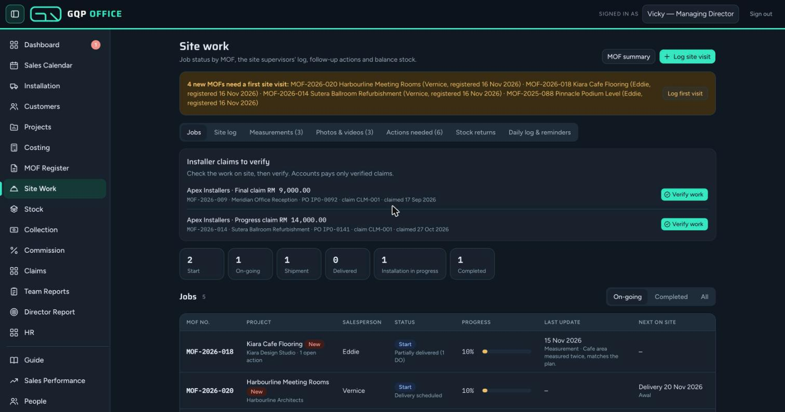

## Site Work detail
One site's stage and progress, leftover stock recorded from it, and the log of site visits with their notes
and links. Site supervisors log visits and update the stage.

Used by: MD, Sales Director, BD Director, Sales, HR & Accounts, Site Supervisor, Purchasing.

## Claims
One monthly claim per person, for commission and travelling costs. The sidebar says **My claims** for staff and
**Claims** for managers. A claim runs: Draft, Submitted, Checked (HR & Accounts), Approved (HR & Accounts or the MD),
Paid (HR & Accounts only). A claim can be Returned from Submitted or Checked, and the person fixes it and sends it again.
Expenses dated after the cut-off day (25 by default, MD can change it) go to next month's claim.

**Your claim** has three sections.
- **A. Commission.** Orders that are 90% or more paid. Tick the ones to claim and the late-collection cut is shown. A line
  in a claim that is waiting or approved cannot be claimed again; it is free again once the claim is paid.
- **B. Travelling.** Petrol, Toll, Parking, Outstation meals, Hotel, Mileage (per km), Grab and Others. Each line gets a
  receipt number (R1, R2...) and a photo, except Mileage. The screen warns, but never blocks, when there is no visit
  logged that day, the hotel is over budget, meals are claimed twice, a day is over 150 km, or petrol, toll and parking
  pass the monthly limit in the person's HR package. Mileage does not count toward that monthly limit.
- **C. Overtime.** The month's approved overtime and replacement leave are added up for you. This section shows only for
  Site Supervisors, or when the person has an overtime entry that month; the Travelling section is numbered B only for
  people who claim commission.

You can only send the claim after last month's report is submitted. The checker and the approver see the warnings and
must write a remark when a claim has any. After a claim is Submitted, the checker and approver can adjust a line with a
reason; adjustments lock once it is Approved. The claim shows the original amount next to the final amount. When
approving, the app writes the commission payout in the same step, so an approved claim never lacks its payouts.
The checker can also tick "original receipts received" and, for a late-collection cut, waive it only when an approved
appeal exists.

**Managers** also get an **All claims** tab (who has not submitted, open and approve), an **Appeals** tab (moved here from
Commission, which keeps a link), an **Overtime to decide** list, and **Settings** (cut-off day, mileage rate, km per day
limit, travel limit, the report-first rule). The late-collection cut percentages stay on Commission settings (MD only).

**Print.** A4 monthly claim form with sections A to C, signatures for Claimed, Checked and Approved by, and the
original-versus-final box. It leaves out the invoice date, a meals column and the overtime approver's name.

Used by: everyone with a job role for their own claim; MD and HR & Accounts to check and approve.

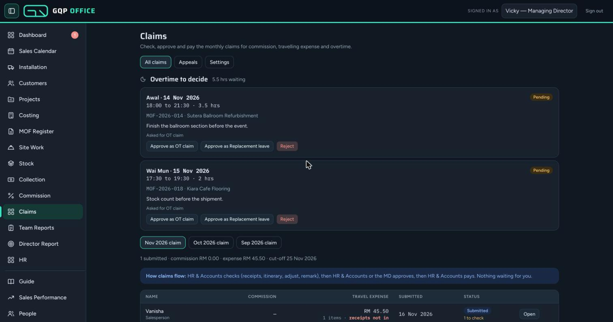

## Overtime
Night and weekend work claims. The page is no longer in the sidebar: staff open the form from **Claims**. Staff add a claim with the time and the job; the MD or Sales Director approves
it as paid overtime or as replacement leave, or rejects it. HR & Accounts can decide too.

Used by: MD, Sales Director, BD Director, Sales, HR & Accounts, Site Supervisor, Purchasing.

## Stock
Four tabs: **Reserved for clients**, **Stock items**, **Leftover stock at Best Link (N)** and **Samples at Best Link
(N)**. Four tiles on top: Active reservations, Expired - follow up, Expiring soon and Supplier emails to send.
Reservations show stock held for a client or project, with the hold date and the next step (confirm, PO issued,
delivered, release, extend). Stock items is the catalogue. Both can be pasted from a sheet or downloaded as CSV.
- **Supplier emails**: a change to a reservation (reserve, extend, release) flags the supplier to be told.
  **Email suppliers (N)** shows one draft per supplier, with the subject and the lines. **Open in email app** opens a
  draft in your own email program (the address is empty: add it there), and **Mark as sent** clears the flag. Nothing
  is sent by the app, and supplier addresses are not stored.

Used by: MD, Sales Director, BD Director, Sales, HR & Accounts, Purchasing, Marketing.

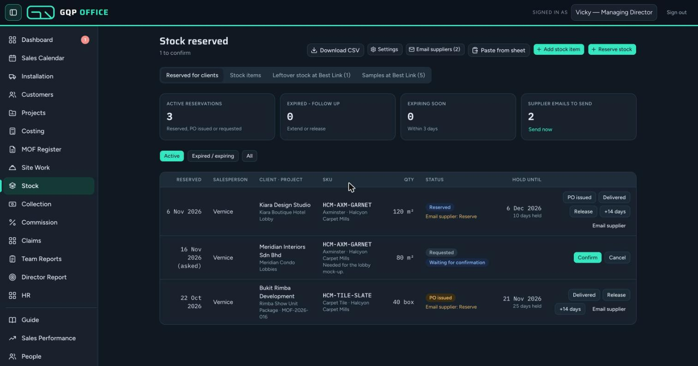

## Samples
The samples GQ keeps at the Best Link warehouse (carpet tile, vinyl tile and so on), one line per SKU: product,
brand, SKU, name, size, quantity at Best Link, who has some out, notes and when it was updated. Search, and filter by
product and brand. Three tiles: Sample SKUs, Taken out not back, None left. Paste from a sheet adds or updates lines;
existing lines are skipped unless you choose otherwise.
- **Take out** records who took a sample and for whom (client, project or showroom); tick "client keeps it" when it will
  not come back. **Back** ticks what has come back. The quantity changes only through these records.
- **Pickup forms**: select samples and click **New pickup form** to collect them from Best Link. The form is numbered
  SR-0001, SR-0002 and so on when it is saved, and saving takes the samples out of stock. A line over what is in stock
  is refused, and its unit must be the sample's own unit. It holds the person in charge, contact, method (Lalamove,
  Self pick-up or Transporter), date, driver, vehicle, address, up to 10 lines, signature, IC and received date.
- **Print**: a bilingual (Chinese and English) V-GQ Signature Receipt on one A4. **I saved the PDF** marks the date it
  was saved. **WhatsApp Best Link** opens WhatsApp with the Chinese pickup text.
- **Settings**: the Best Link WhatsApp number, the Drive folder link where pickup forms are kept, and the next form
  number.
- Who can edit: MD, Sales Director, Purchasing, stock arrangers, HR & Accounts and Marketing. Everyone else reads.
- **Not built**: deleting a pickup form from the screen (the database allows it).

Used by: MD, Sales Director, BD Director, Sales, HR & Accounts, Purchasing, Marketing.

## Leftover stock
Offcuts and spare stock from finished jobs, on two tables.
- **Leftover stock at Best Link**: what is at the warehouse. Item, from job, condition, available (after what has been
  used), how many days it has been there and what it was used for. Search by item, colour or MOF; **Show sold out**
  shows the used-up lines. **Use for project** gives some to another project with a quantity, date and note, and it
  cannot take more than is available. Uses are added only; they cannot be edited or deleted.
- **Returns from site**: items on their way back, from pickup to the supplier's credit note. The status is Pending
  pickup, Collected by supervisor, Returned to supplier, At Best Link (for resale), Left with client or Disposed.
  **Update** sets how it goes back (installer, transport or supervisor), the transport (Lalamove, GQ lorry or another
  transporter, with date, cost and where it goes), the supplier, why GQ keeps it (Custom made, Indent from China, GQ own
  stock, Salesperson ordered wrong stock and who, or Others), the credit note number and amount, and the condition.
  The status cell shows the transport, whether the office has the WhatsApp, who collected it and who received it.
- A site supervisor opens the job in Site Work and taps **Mark collected**, saying how it is going back and where they
  took it.
- Tiles count what waits for pickup, needs transport or waits for a credit note.
- **Not built**: adding leftover stock without a MOF.
- The Sales Director sees only the rows of MOFs he can read, so his Best Link count is lower than the MD's.

Used by: MD, Sales Director, BD Director, Sales, HR & Accounts, Purchasing, Marketing. A Site Supervisor marks
collection from Site Work.

## Collection
Invoice, received and outstanding amount per order, with payment status. Commission opens at 90% paid. Open an
order to see or enter payments.

Used by: MD, Sales Director, BD Director, Sales, HR & Accounts.

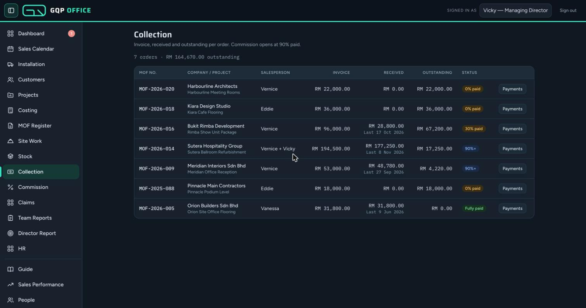

## Commission
What each person has earned on money received, what was paid out and what is left. One block per person, one
row per MOF, with the rate and status.

Money still unpaid after 90 days loses 25% of the commission and after 180 days loses 50% (this was 120 days).
The new 180 days applies to all commission not yet paid out; commission already paid is never changed. A salesperson
can appeal a late cut on their own line with a written reason (at least 10 characters). The MD
or HR & Accounts approves or rejects it on the **Appeals** tab (now under **Claims**), and cannot decide their own. An approved appeal
sets that late cut to zero and the row shows "Special approval by" the decider. A rejected appeal is kept, and a
new appeal can be made.

Used by: MD, Sales Director, BD Director, Sales, HR & Accounts.

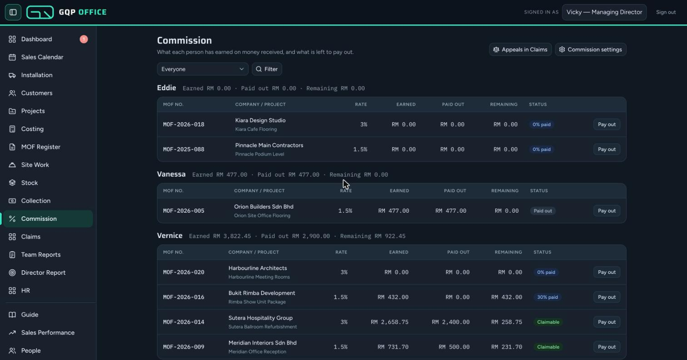

## Commission settings
The rules every commission is worked out from. Per-person exceptions are set on People.

Used by: MD and admins.

## Team Reports
Monthly reports for the whole team, for salespeople and for site supervisors, with figures taken from the
calendar, projects and MOFs. They freeze when a report is submitted. People who are not managers see My Report
instead, their own monthly report.

Review has two steps. A submitted report goes to the person's team lead (or the MD), who reviews it; then the MD
gives the final approval. A director's report goes to the MD only. Reports reviewed before this change count as
approved. **Print report** gives an A4 page with Prepared, Reviewed and Acknowledged signature lines. The Marketing
Director's report is titled "Marketing director monthly report".

The site supervisor report is now in three parts: the itinerary (one line per site per day, against the target
of 50, with a schedule check), the shooting and handover table with stock returns, and remarks. The overtime table and activity summary are no longer on it.

Used by: MD, Sales Director, HR & Accounts (team view); Sales and Site Supervisor (own report).

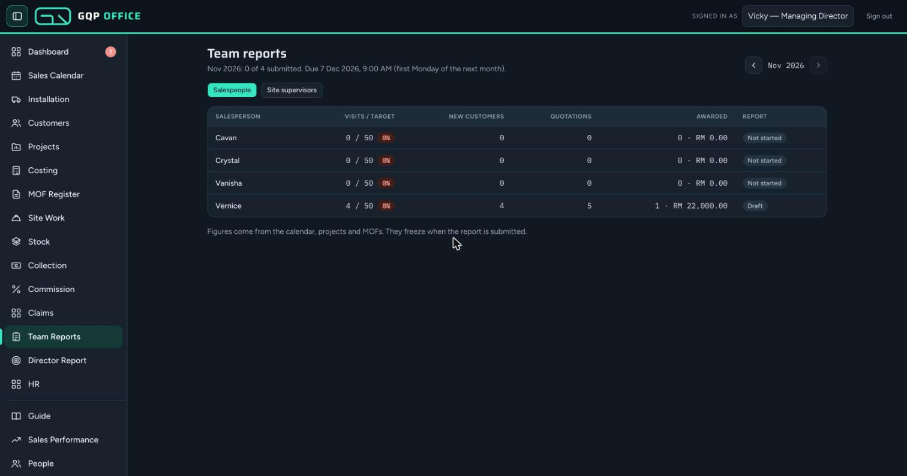

## Director Report
The BD Director's monthly report, seen by the MD and HR & Accounts. The Sales Director sees only a pointer to
Team Reports.

Used by: MD, Sales Director, BD Director, HR & Accounts.

## Tasks
Work handed between people, with a due date and a review step. Tabs: **My tasks**, **Assigned by me**, **All tasks**
and **Workload** (MD and Sales Director). Tiles show overdue, due this week, waiting review and revision. Click a task
to open its sheet: log, files (each upload is a new version) and the review panel. The flow is Not Started, In
Progress, Pending Review, Revision Required, Completed. Only the person who assigned a task, or the MD, approves it; a
revision needs a comment. The MD, Directors, BD, Sales support and Marketing can assign tasks. Reminders are in the
app only (tiles and overdue marks); WhatsApp reminders come later. A task cannot be edited after it is made yet.

Used by: everyone with the Tasks page.

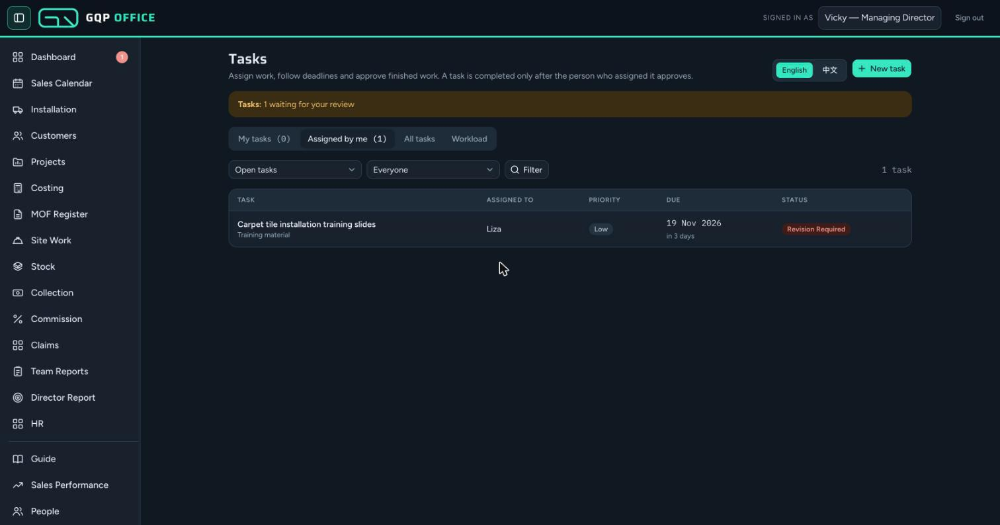

## HR
Pay and policy papers for the whole company. Only the MD and HR & Accounts can open it. The **admin** role alone does
not give access, and **View as** cannot show it to anyone else. Three tabs.

**Policies & schemes.** The company's policy documents, each with a category, version, effective date and either a PDF
or a link. When a new version **Replaces** an older one, the older one is marked **Older** by itself. Tick "scheme
appendix" for the document staff sign for their pay scheme. The scheme summary (bonus bands, commission, terms) and
the extra rules log sit alongside. A PDF can be up to 1.5 MB for now; use a link for bigger files.

**Staff packages.** One line per person: basic pay, allowances and claim cap, with a dated history. Packages are
add-only: to fix a typo, add a new line on a new date. Standard packages for salespeople and site staff, and the
outstation rules (meal and hotel by level), are here too. Confirmation date, offer letter and notes are kept per
person. Packages start empty: HR & Accounts types them in.

**Sales grades & bonus.** Grades J1 to M2 with basic pay and annual target, editable. Each person's grade is set here. The
bonus bands are a reference only (below 100% of target none, 100-124% one month's basic, 125% and above three months',
on full-year sales); the app does not work bonuses out. Marking "appendix signed" records the current scheme version.
English with a 中文 toggle.

Used by: MD, HR & Accounts.

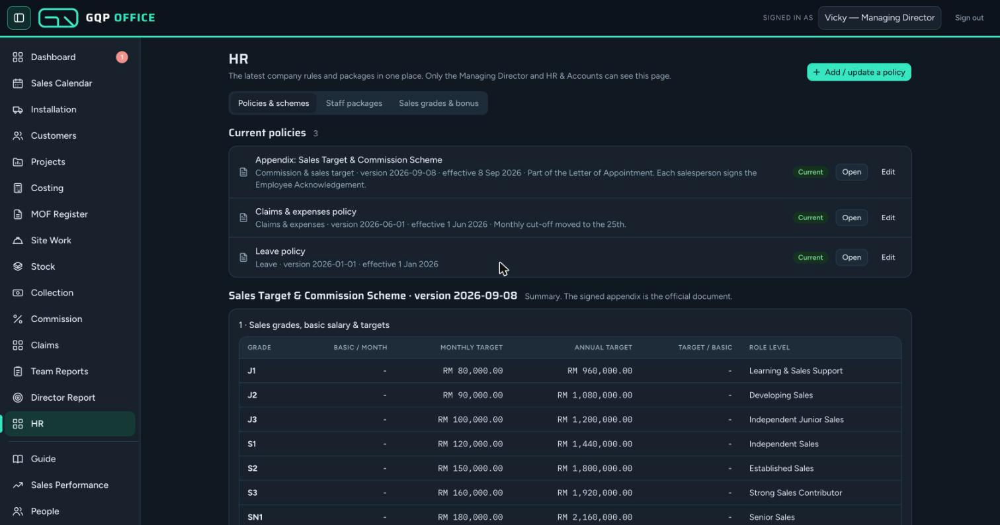

## Tools & Forms
Small helpers for everyone, in the sidebar just before Leave. Tabs: **Wallpaper calculator**, **Vinyl sheet calculator** and **Forms to print** (the forms tab also holds Best Link and the Drive links).

**Wallpaper calculator.** Pick European (0.53 m by 10.06 m roll), Korean (1.06 m by 15.5 m) or Fabric Back (1.37 m
wide, by the running metre), enter the wall width and height, and it shows the panels and the rolls to order.

**Vinyl calculator.** Enter the room length and width plus skirting, the roll width and length. It suggests layout A or
B and the welding rod needed, using the same numbers as Vicky's demo.

**A4 forms.** Site measurement summary, work commencement acknowledgement and project handover (HO-01). Print them
blank or filled in from a MOF (any MOF except cancelled or closed; the newest 80 are listed). Printed forms are in
English. The **Best Link** row (sample pickup form) opens Stock for now and moves to Samples when that page is built.

**Drive links.** Shortcuts to company folders. Only admins add or remove them.

English with a 中文 toggle.

Used by: everyone.

## Leave
Apply for leave and see balances. Tabs: **My leave** (balance tiles and requests), **Waiting for approval**, **Team
leave** (MD, Sales Director, HR & Accounts), **Who is away** (a month grid) and **Public holidays** (the MD edits).
Types: Annual, MC, Emergency, Hospitalisation, Replacement, Compassionate, Maternity/paternity, Unpaid; only Annual and
Emergency use up annual leave. Each person gets 14 annual and 14 MC days a year, prorated by join month to the half
day. Balances start on 1 Jan 2027: HR & Accounts enters each person's carry-forward from 2026 in the entitlements
sheet. Days count Mon-Fri (Mon-Sat for Site Supervisors) without public holidays; half days count 0.5. A request goes
to the right approvers by job role (never yourself): sales to their team lead then the MD; BD and site to the Sales
Director then the MD; everyone else to the MD; HR & Accounts also sees MC. MC and hospitalisation need a slip upload
and a tick that the original went to HR. English with a 中文 toggle.

Used by: everyone with the Leave page.

## Guide
A short in-app list of the screens the signed-in role can open and what each is for.

Used by: everyone.

## Sales Performance
Sales, margin and collection per salesperson for a year, against each person's yearly target. A target is
prorated for the months someone joined or left, with a "Joined" or "Left" note. Tiles show the totals and the Best
month. Click a person to see their MOFs with sales, margin %, margin RM, collected, outstanding and status. A team
panel with a monthly bar chart compares the two directors' teams. A director with no awarded sales is hidden.

Used by: admins.

## People
Admins add people, set their job role and commission mode. Admin-only features that need the
service key show a "can't be tried on your laptop" message on a local copy.

**Targets per year.** On a person's sheet the MD, Sales Directors and HR & Accounts set a sales target and a visit
target (visits per month) for this year or next. With no yearly line, the person's grade target from HR applies. Sales
Performance keeps working: the yearly target it reads follows this year's line, and refreshes itself on the first
visit of a new year.

**Sales teams.** A panel listing each team lead's team.

**Resignation handover.** For someone who is leaving, an admin picks a person to take over. Their customers (including
archived ones) and open projects (every stage except Awarded and Lost) move across, and a handover list is saved.
Commission on the leaver's MOFs stays with the leaver; nothing is recalculated. These parts are in English only.

Used by: admins.

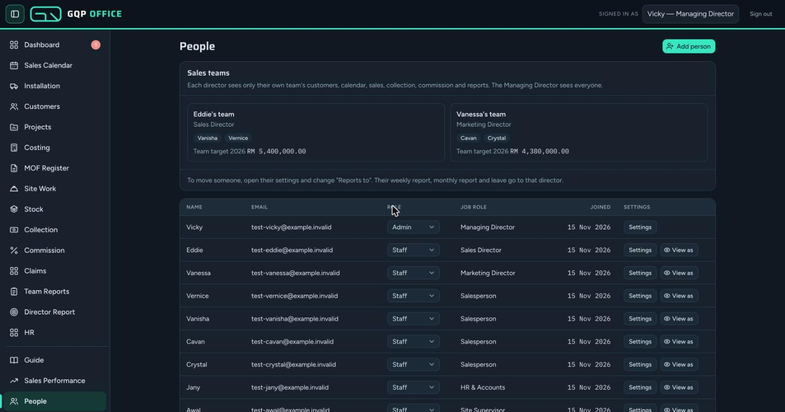
