# Features

One section per screen, in sidebar order. Screenshots are the Sales Director's view of the test copy with its
example records, so a colleague with another job role sees fewer or different screens and records. The in-app
**Guide** lists what each role can open.

Job roles: MD, Sales Director, Marketing Director, Salesperson, HR & Accounts, Site Supervisor, Purchasing, Sales support, Designer, Marketing Executive. The MD sets which pages each role sees in People ("What each role can see") and can open the app as anyone with **View as** (read only).

## Contents
- [Header and sidebar](#header-and-sidebar)
- [Sign in](#sign-in)
- [Dashboard](#dashboard)
- [Sales Calendar](#sales-calendar)
- [Installation](#installation)
- [Costing](#costing)
- [Customers](#customers)
- [Customer detail](#customer-detail)
- [Ownership requests](#ownership-requests)
- [Projects](#projects)
- [MOF Register](#mof-register)
- [MOF detail](#mof-detail)
- [Site Work](#site-work)
- [Site Work detail](#site-work-detail)
- [Overtime](#overtime)
- [Stock](#stock)
- [Leftover stock](#leftover-stock)
- [Collection](#collection)
- [Commission](#commission)
- [Commission settings](#commission-settings)
- [Team Reports](#team-reports)
- [Director Report](#director-report)
- [Guide](#guide)
- [People](#people)

## Header and sidebar
The header shows the logo, the app name, who is signed in (name and job title) and **Sign out**. The sidebar lists the
pages the person's role may open, then a divider, the **Guide**, and the pages that sit below it (Sales Performance and
People for admins). A badge on a link shows a count, e.g. open ownership requests on the **Dashboard**. The menu button
at the top left collapses the sidebar to icons on a laptop and opens it as a drawer on a phone; the laptop choice is
remembered in the browser.

Used by: everyone.

## Sign in
Invite-only sign-in with the email and password an admin set up. There is no public sign-up.
"Forgot password?" shows a note to ask an admin, who makes a new link on the People page. No emails are sent.

Used by: everyone.

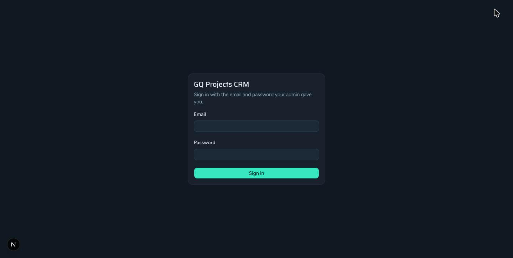

## Dashboard
Headline numbers for the month: what needs attention, visits against target, new customers, open pipeline,
awarded and yearly sales, and money still outstanding, with a row per salesperson. Salespeople and site
supervisors get a personal version.

Used by: MD, Sales Director, BD Director, Sales, HR & Accounts, Purchasing.

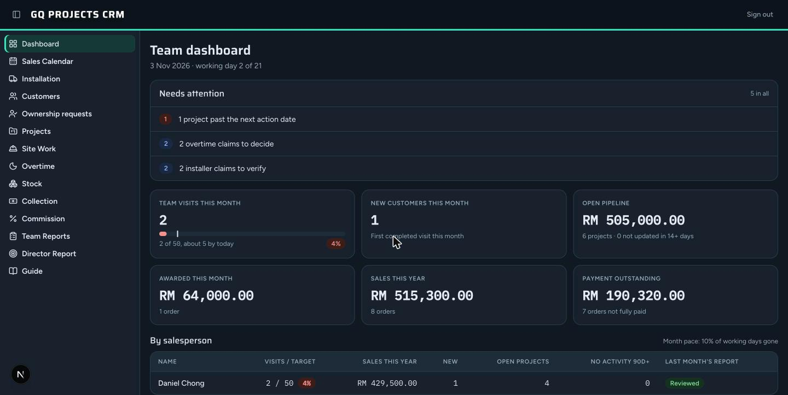

## Sales Calendar
Visits, calls and follow-ups by month or week, filterable by person. Add an entry from any day.

Used by: MD, Sales Director, BD Director, Sales, HR & Accounts.

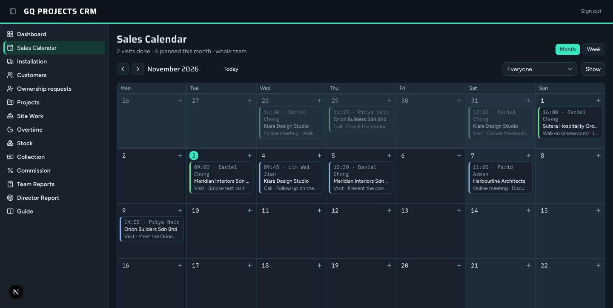

## Installation
Delivery, site measurement, handover and installation jobs on a calendar. Schedule a job, or book a site
supervisor when one is free. Site supervisors see it as the Installation Calendar, Purchasing as Delivery &
Installation.

Used by: MD, Sales Director, BD Director, Sales, HR & Accounts, Site Supervisor, Purchasing.

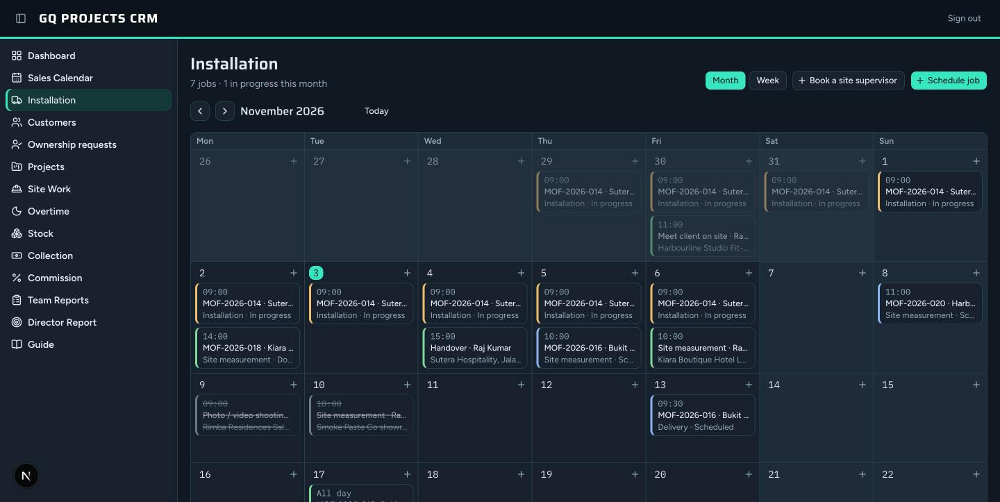

## Costing
Quotes with revisions (Original, R1, R2) and options (A, B, C) built from line items; sell, cost and margin per option.
Screens: **Register** (`/costing`: search, status filter, sort), **New quote**, **Quote record** (`/costing/[id]`:
editor, history, client quote button), **Approvals** (below-minimum-margin quotes: approve or return with a note),
**FOB Enquiry** (`/costing/enquiries`: ask for a supplier price, purchasing and support reply), **Client quote**
(`/costing/[id]/preview`: one option or a comparison, print, copy as TSV). Projects show their costing lines on the
card. A quote at or above the minimum margin (30%) is confirmed by its owner; below it needs a reason and the MD or a
Director approves. People without the "See margin % and cost" access see "Low / High margin" and no costs. English
with a 中文 toggle. Sales Directors, the MD, Sales support and HR & Accounts see every quote; salespeople see their own.

Used by: MD, Directors, Salespeople, Sales support, HR & Accounts, Purchasing (FOB Enquiry).

## Customers
Every customer with company, mobile, owner, rating, account type and activity. Search and filter, add a
customer, paste rows from a sheet or download a CSV. The mobile number decides who owns a customer.

Used by: MD, Sales Director, BD Director, Sales, HR & Accounts.

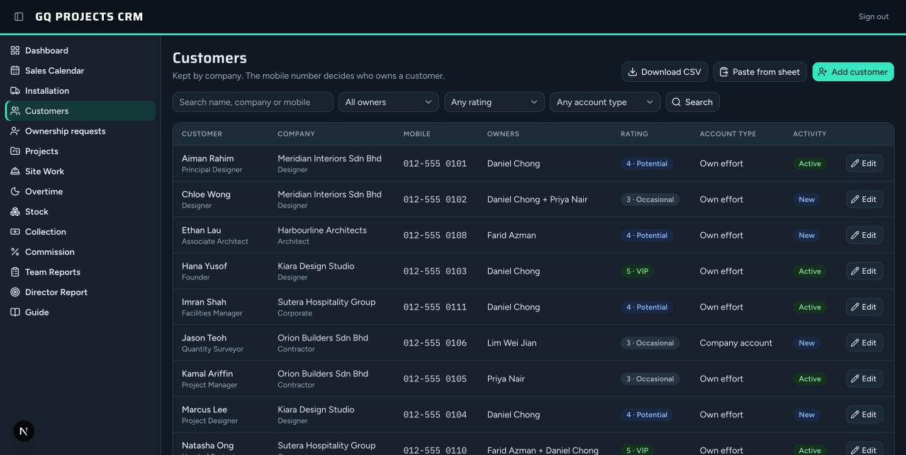

## Customer detail
One customer's contact details, owners, rating and health, colleagues at the same company, and the activity
history with the option to log a new one. The owner or a manager edits it; anyone else can ask for ownership.

Used by: MD, Sales Director, BD Director, Sales, HR & Accounts.

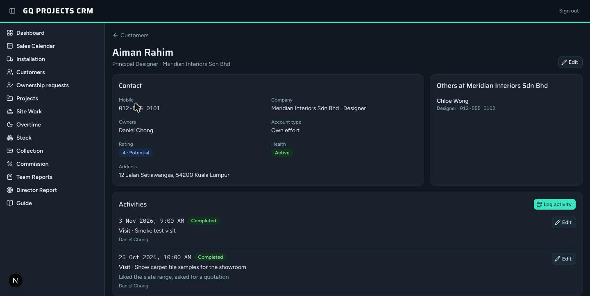

## Ownership requests
Requests from a salesperson to take over a customer, with the reason, who owns it now and the outcome.
Managers approve or reject; approving makes the requester the owner.

Used by: MD, Sales Director, BD Director, Sales, HR & Accounts.

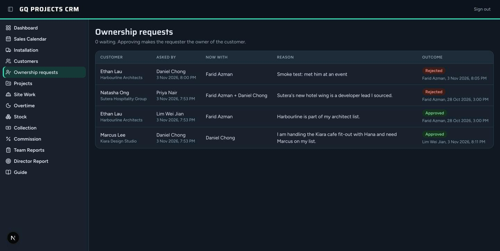

## Projects
Every deal by stage from lead to job, as a board or a list, with value, area, estimated commission and the
next action date. Overdue next actions are flagged and a project's stage changes from its card.

Used by: MD, Sales Director, BD Director, Sales, HR & Accounts.

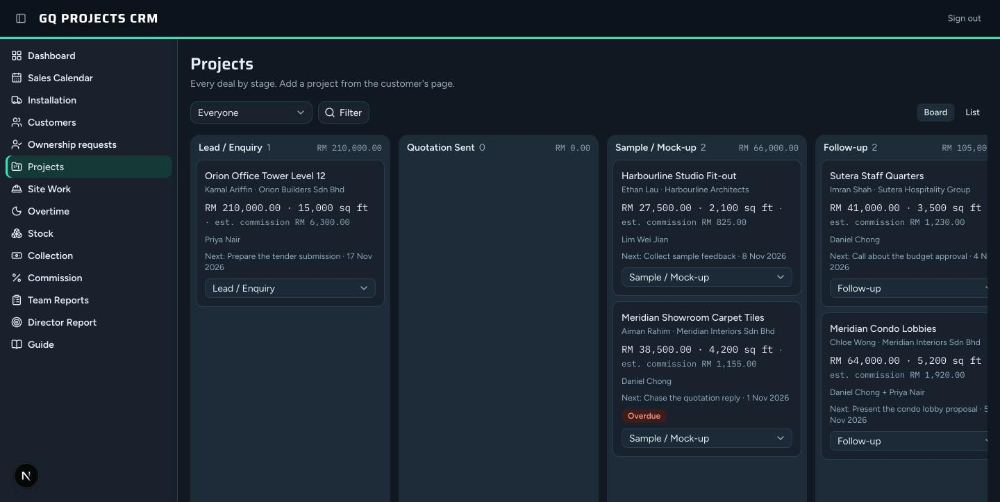

## MOF Register
The register of client purchase orders (MOFs): the order as it comes in, then supplier orders and deliveries.
Salespeople see their own as My Sales. Paste from a sheet or export to CSV. HR & Accounts can read it but not
change it.

Used by: MD, BD Director, Sales, HR & Accounts, Purchasing.

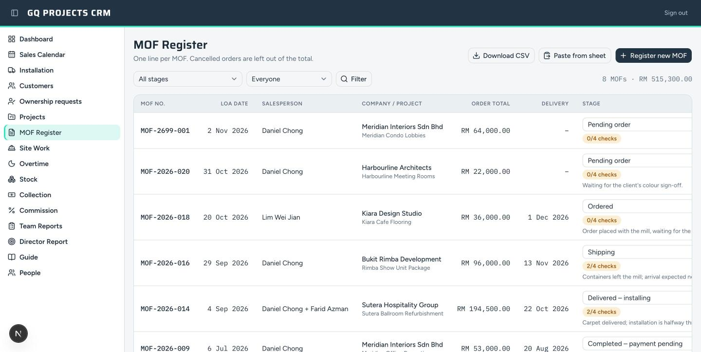

## MOF detail
One MOF with its products, contract sum and variation orders, supplier purchase orders, delivery jobs and
installer claims. A new MOF is registered here once the PO or LOA is received.

Used by: MD, BD Director, Sales, HR & Accounts, Purchasing.

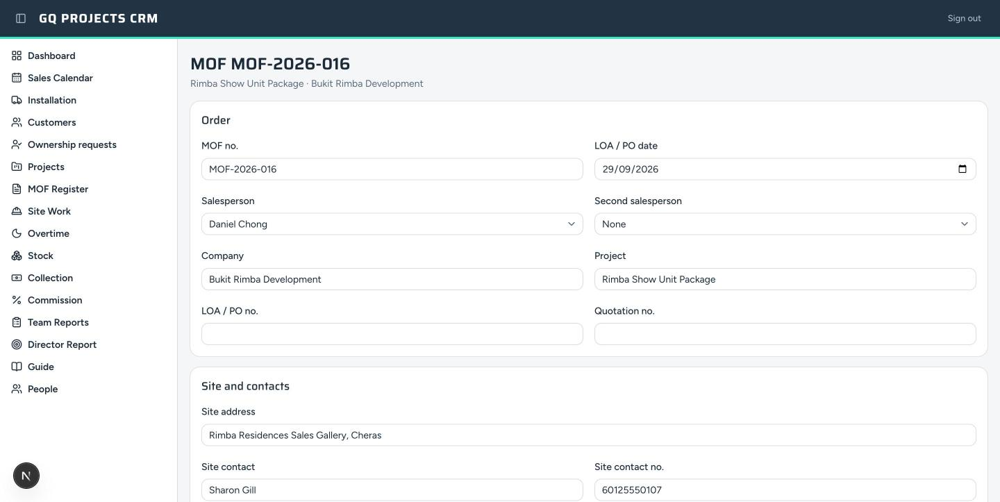

## Site Work
Open orders with how far each site has got, plus installer claims waiting to be verified. Accounts pays only
verified claims. Open a site to log a visit.

Used by: MD, Sales Director, BD Director, Sales, HR & Accounts, Site Supervisor, Purchasing.

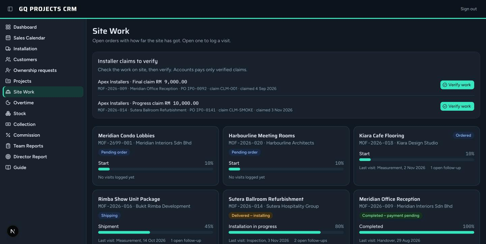

## Site Work detail
One site's stage and progress, leftover stock recorded from it, and the log of site visits with their notes
and links. Site supervisors log visits and update the stage.

Used by: MD, Sales Director, BD Director, Sales, HR & Accounts, Site Supervisor, Purchasing.

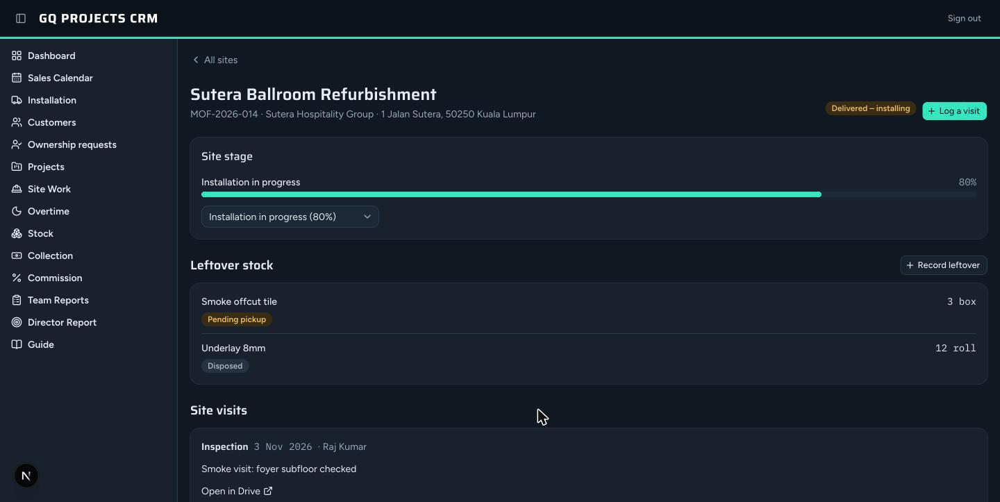

## Overtime
Night and weekend work claims. Staff add a claim with the time and the job; the MD or Sales Director approves
it as paid overtime or as replacement leave, or rejects it.

Used by: MD, Sales Director, BD Director, Sales, HR & Accounts, Site Supervisor, Purchasing.

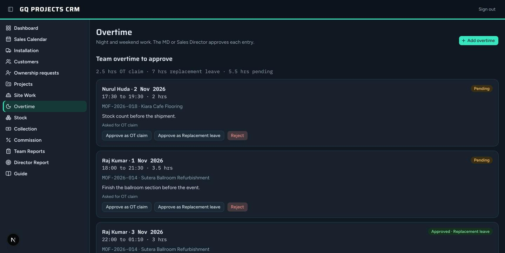

## Stock
Three tabs. Reservations show stock held for a client or project, with the hold date and the next step
(confirm, PO issued, delivered, release, extend, email the supplier). Stock items is the catalogue. Both can be
pasted from a sheet or downloaded as CSV.

Used by: MD, Sales Director, BD Director, Sales, HR & Accounts, Purchasing.

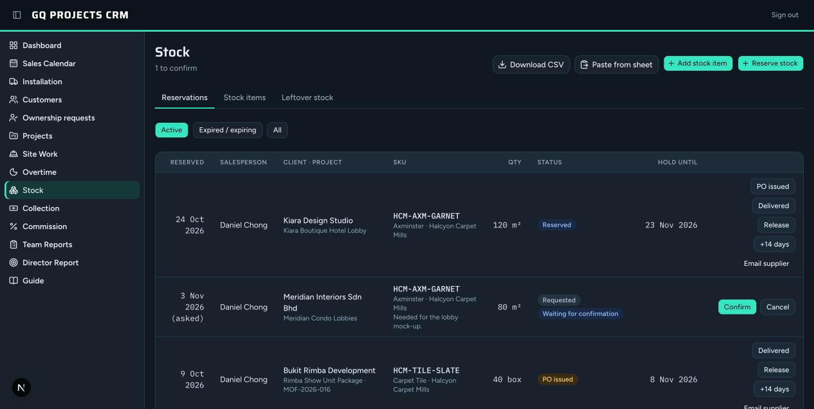

## Leftover stock
Offcuts and spare stock from finished jobs: condition, whether it returns to the supplier or stays at the
warehouse, and where it has got to (pending pickup, returned with credit note, disposed).

Used by: MD, Sales Director, BD Director, Sales, HR & Accounts, Purchasing.

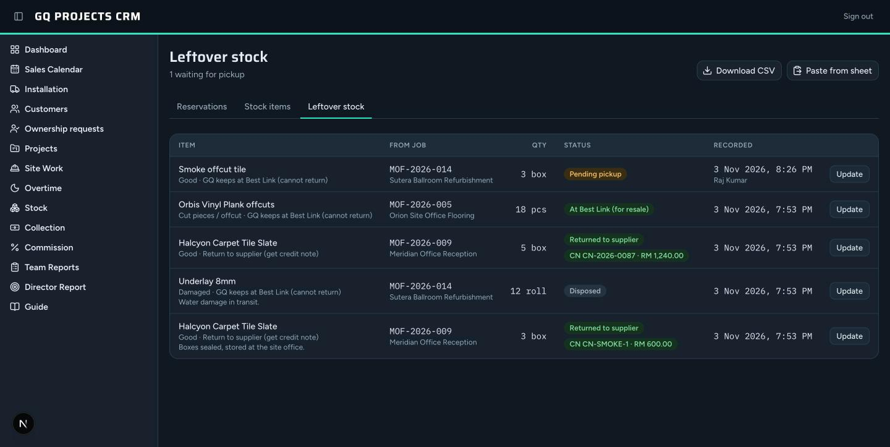

## Collection
Invoice, received and outstanding amount per order, with payment status. Commission opens at 90% paid. Open an
order to see or enter payments.

Used by: MD, Sales Director, BD Director, Sales, HR & Accounts.

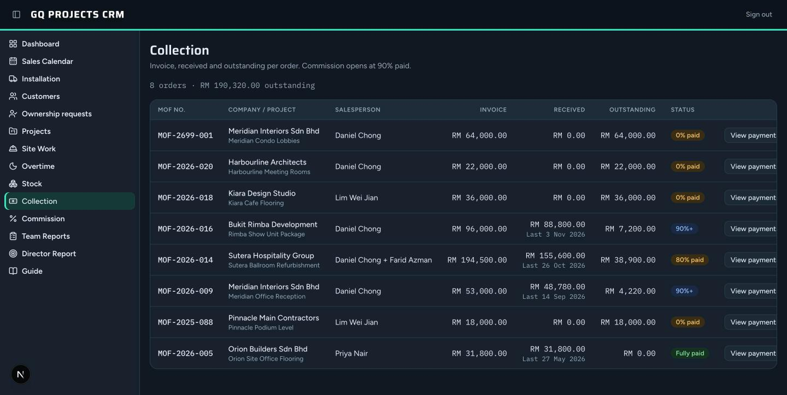

## Commission
What each person has earned on money received, what was paid out and what is left. One block per person, one
row per MOF, with the rate and status.

Used by: MD, Sales Director, BD Director, Sales, HR & Accounts.

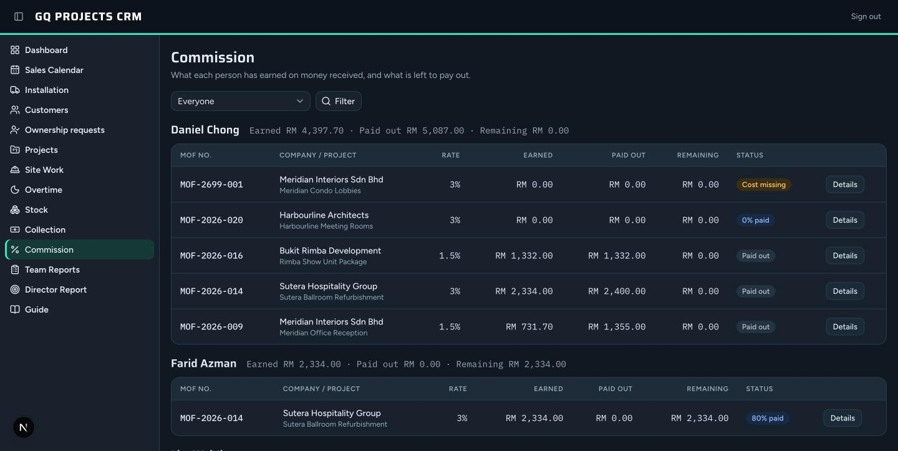

## Commission settings
The rules every commission is worked out from. Per-person exceptions are set on People.

Used by: MD and admins.

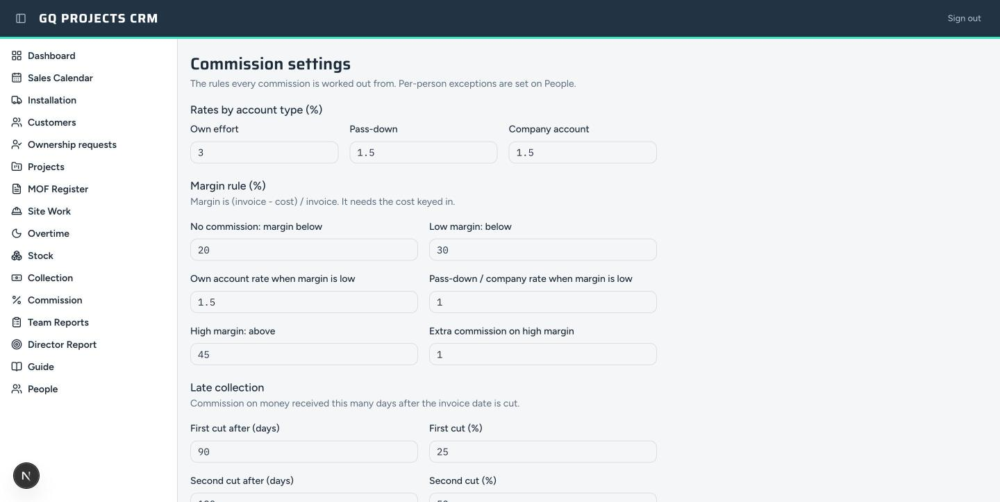

## Team Reports
Monthly reports for the whole team, for salespeople and for site supervisors, with figures taken from the
calendar, projects and MOFs. They freeze when a report is submitted. Managers open a report to review it.
People who are not managers see My Report instead, their own monthly report.

Used by: MD, Sales Director, HR & Accounts (team view); Sales and Site Supervisor (own report).

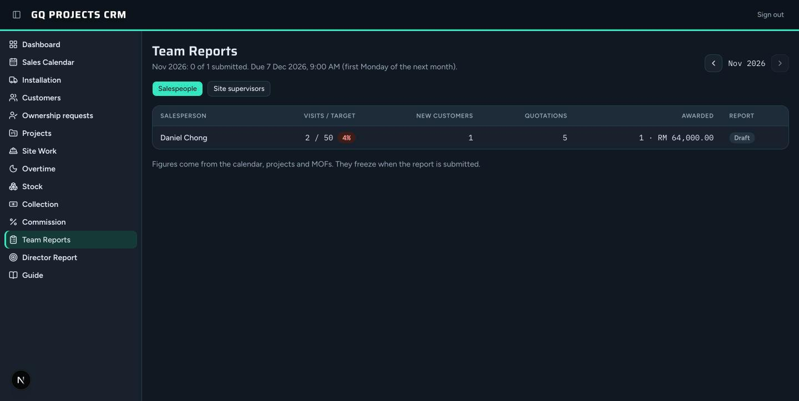

## Director Report
The BD Director's monthly report, seen by the MD and HR & Accounts. The Sales Director sees only a pointer to
Team Reports.

Used by: MD, Sales Director, BD Director, HR & Accounts.

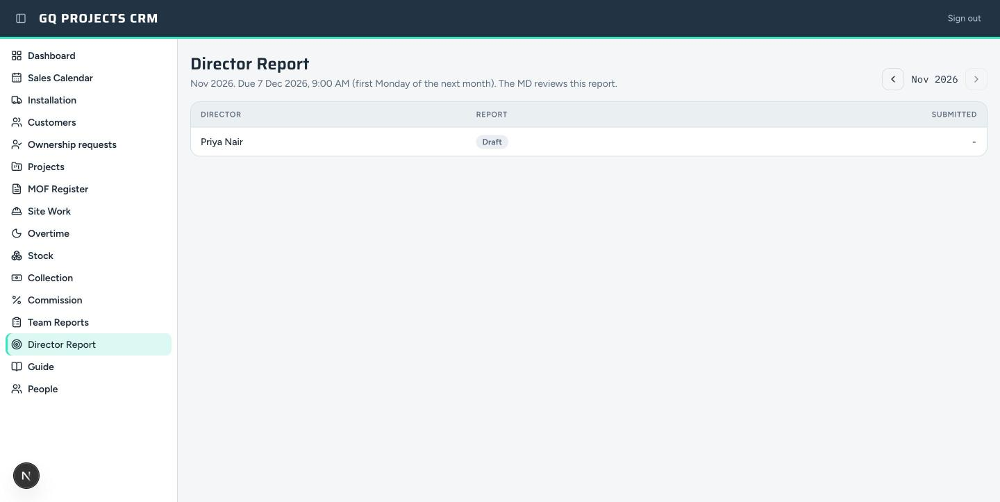

## Guide
A short in-app list of the screens the signed-in role can open and what each is for.

Used by: everyone.

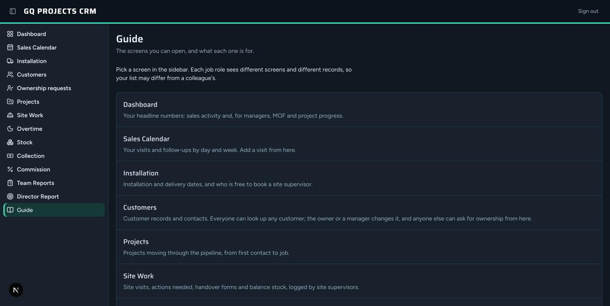

## People
Admins add people, set their job role, commission mode and yearly target. Admin-only features that need the
service key show a "can't be tried on your laptop" message on a local copy.

Used by: admins.

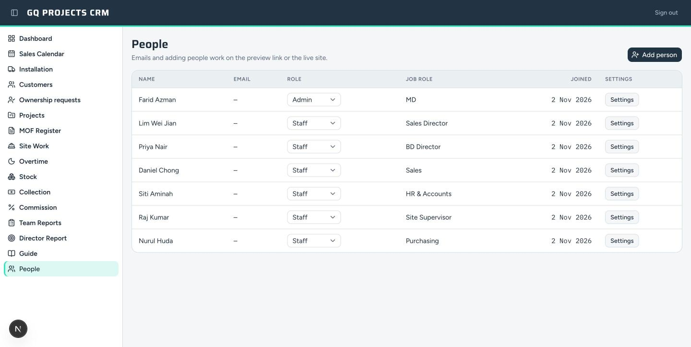
